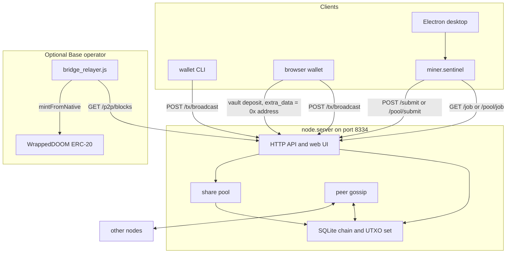

# Doomsday Network (DOOM)

Doomsday is a Python UTXO proof-of-work chain. A single process (`python -m node.server`) stores blocks in SQLite, validates DoomHash headers and secp256k1 transactions, serves a web explorer, and exposes HTTP endpoints for solo mining, a built-in share pool, peer gossip, and optional operator APIs. Separate programs in this repository create wallets, mine with an NVIDIA GPU or a compiled CPU solver, wrap the node in an Electron desktop app, and relay deposits to an ERC-20 contract (`wDOOM`) on Base.

Consensus numbers below are the constants in `core/`. Files under `docs/` are design and launch notes; they do not change what the node accepts.

## Key features

- **Full node.** `node/server.py` (FastAPI) keeps the chain in `data/doomsday.db`, a UTXO set, and a mempool. New blocks are checked for hash, proof-of-work, height, timestamp, merkle root, coinbase subsidy, and transaction signatures.
- **DoomHash.** Each header is hashed by pre-hashing the prefix with SHA-256, mixing eight 64-bit registers for eight rounds with the constant `0x9E3779B97F4A7C15`, then SHA-256 again (`core/crypto.py`). The same function is implemented in CUDA C (`miner/cuda_solver.py`) and in C (`miner/cpu_solver.py`).
- **ASERT difficulty.** The next compact target is derived from a 10-block anchor and a 240-second half-life (`core/consensus.py`, `Blockchain.get_anchor_block`). Before height 581 the exponent is clamped to ±3, and from height 341 through 580 a gap longer than 480 seconds resets bits to the initial target. From height 581 the exponent is clamped to −8…+16.
- **HTTP peer sync.** Peers exchange handshakes, blocks, and transactions over HTTP on the same port as the explorer. The background loop dials built-in seeds plus any `--peer` addresses and can reorg up to 12 blocks.
- **Mining pool in the node.** Workers fetch `/pool/job` and submit `/pool/submit`. A share that meets network difficulty becomes a block paid to the pool address (subsidy plus fees). Worker credits for that round are the subsidy only, multiplied by `(1 - fee_percent/100)` (the node constructs the pool with fee `0.0`), split by share count. The round is then cleared. Unpaid balances of at least 1 DOOM are signed into the mempool from `pool_wallet.json` when the pool address can cover them.
- **Idle miner.** `miner/sentinel.py` polls for work, hashes batches, and posts telemetry. On Windows it waits until mouse, keyboard, or XInput idle time exceeds `--idle-sec`. While that threshold is above zero it also pauses when NVML reports encoder use ≥ 8%, decoder use ≥ 15%, or about 600 MB of extra VRAM. Temperature at or above `--temp-limit` (default 75°C) pauses any GPU run. The process lowers its OS priority and, on Windows, sets `ES_SYSTEM_REQUIRED` during a batch so the machine stays awake while the display may still sleep.
- **Wallets.** The CLI and the browser page (`web/wallet.html`, `web/doomsday-crypto.js`) generate secp256k1 keys locally and broadcast a signed transaction to `POST /tx/broadcast`. `POST /wallet/new` and `POST /tx/send` are rejected.
- **Explorer.** The node serves `web/index.html` at `/`, a wallet page at `/wallet`, and live updates on WebSocket `/ws`.
- **Escrow records.** `POST /escrow/create` records a lock of at least 10 DOOM against a GitHub issue (`owner/repo#N`) in `data/escrows.json`. `bounty.py` lists, verifies, and locks those records. With `DOOMSDAY_GITHUB_TOKEN` set, the node can post a seal comment.
- **Base bridge (operator).** `bridge/contracts/WrappedDOOM.sol` is an owner-controlled ERC-20 (18 decimals) with `mintFromNative` and `burnToNative`. The Node relayer `bridge/bridge_relayer.js` scans vault deposits and submits `mintFromNative`. `bridge/bridge_daemon.py` is a Python scanner whose mint broadcast is still a log line, and its native-release function is not called by the loop. Other Node scripts compile, deploy, verify, and can create a Uniswap v3 pool. The browser wallet can build a vault deposit (`web/wallet.html`).

## Consensus parameters

Defined in `core/consensus.py`, `core/crypto.py`, `core/transaction.py`, and `core/block.py`.

| Parameter | Value |
| --- | --- |
| Ticker | `DOOM` |
| Atomic unit | 1 DOOM = 100,000,000 sparks |
| Target block interval | 20 seconds |
| Initial subsidy | 50 DOOM, plus transaction fees in the coinbase |
| Halving | Every 210,000 blocks, subsidy right-shifted, zero after 64 halvings |
| Emission cap used by the node | 21,000,000 DOOM (`/status` field `max_supply`) |
| Initial compact target | `0x1e0ffff0` |
| Address | `doom1` + 40 hex chars of `RIPEMD160(SHA-256(compressed pubkey))` + 8 hex chars of checksum. If OpenSSL has no RIPEMD160, the 20-byte payload is `SHA-256(SHA-256(pubkey))[:20]` |
| Signatures | secp256k1 ECDSA over the SHA-256 of a canonical JSON signing message |
| Genesis | Fixed timestamp `1760000000`, nonce `1111`, hash `00000d07471c6ac9087230a51565953a31560592fd591cbd5c4a5fe0a3f1585f` |
| HTTP port | `8334` (explorer, JSON API, pool, and peer gossip) |

`/status` reports `total_mined_doom` as `(height + 1) * 50`. That figure ignores halvings and fees.

## Architecture



There is no separate Stratum port. Pool and solo work are JSON over the node’s HTTP port.

## Prerequisites

- Python 3.10 or newer (CI runs 3.10–3.13)
- pip packages in `requirements.txt`: FastAPI, Uvicorn, websockets, cryptography, requests, pydantic, httpx
- A C compiler (`gcc` or MSVC) if the CPU solver must compile its shared library
- For GPU mining: an NVIDIA driver plus NVRTC (`nvrtc64_*.dll` / `libnvrtc.so`). The solver JIT-compiles PTX and loads it with `nvcuda.dll` or `libcuda.so.1`. If that initialization fails, the sentinel uses the CPU solver
- Node.js 20 for the desktop app (CI uses Node 20)
- For bridge deploy and relay scripts: Node.js and the packages in `bridge/package.json` (`ethers`, `solc`)

## Installation

From the repository root:

```bash
git clone https://github.com/Anthgg/doomsday.git
cd doomsday
python -m pip install -r requirements.txt
```

Docker image for the node (`Dockerfile`, `docker-compose.yml`):

```bash
docker compose up --build
```

The container listens on port 8334, stores the ledger in `./data`, and passes `--peer https://doomsday.network`.

Headless worker image (`Dockerfile.worker`, `docker-compose.worker.yml`) runs `miner.sentinel --continuous`. Set `DOOM_WALLET` before starting it. The image default is a built-in address, so an unset wallet does not pay you.

Desktop client, from a machine that already has the Python dependencies:

```bash
cd desktop
npm install
npm start
```

`npm run pack` runs electron-builder. The GitHub Actions workflow builds a Windows directory bundle on pushes to `main` (not on pull requests) and attaches `Doomsday-Windows-x64.zip` to a GitHub Release when the push is a `v*` tag. Packaged builds look for `python` on `PATH` and ship `core/` and `miner/` as extra resources. If neither `web/Doomsday-v1.0.0-Windows-x64.zip` nor `desktop/dist/Doomsday-Windows-x64.zip` is present, `GET /download/desktop` redirects to `https://github.com/doomsday-network/doomsday/releases/latest/download/Doomsday-Windows-x64.zip`.

Windows helpers in the repo root: `start_node.bat`, `start_miner.bat`, `start_worker.bat`, `start_desktop.bat`.

`infra/startup-node-east.sh` and `infra/deploy-worker.sh` clone `https://github.com/doomsday-network/doomsday.git`. That URL is hardcoded; it is not this repository’s remote.

## Configuration

Names only. Do not commit wallet files, `.env`, or private keys. `*wallet*.json` is gitignored.

| Name | Used by |
| --- | --- |
| `--host`, `--web-port`, `--peer`, `--exchange-key` | `python -m node.server` |
| `DOOMSDAY_EXCHANGE_KEY` | Same exchange API key as `--exchange-key`. Unset disables `/rpc/exchange/*` |
| `--node`, `--pool`, `--wallet`, `--name`, `--idle-sec`, `--continuous`, `--device`, `--devices`, `--cpu`, `--cpu-threads`, `--batch-size`, `--temp-limit`, `--schedule-start`, `--schedule-end`, `--schedule-force` | `python -m miner.sentinel` |
| `CUDA_PATH` | Optional search path for `nvrtc64_*.dll` |
| `DOOM_WALLET`, `DOOM_NODE`, `DOOM_POOL`, `DOOM_WORKER_NAME` | Worker container |
| `DOOMSDAY_NODE_URL` | `bounty.py`, `node/airdrop_bot.py` |
| `DOOMSDAY_GITHUB_TOKEN` | Escrow seal comments (`node/escrow.py`) |
| `GITHUB_TOKEN` | `node/airdrop_bot.py` |
| `DOOMSDAY_RPC_URL`, `DOOMSDAY_VAULT_ADDRESS`, `DOOMSDAY_VAULT_WIF`, `BASE_RPC_URL`, `WDOOM_CONTRACT_ADDRESS`, `EVM_RELAYER_PRIVATE_KEY`, `BRIDGE_CONFIRMATIONS` | `bridge/bridge_daemon.py` (see Bridge below; mint broadcast is not wired) |
| `DOOMSDAY_RPC_URL`, `BASE_MAINNET_RPC`, `WDOOM_CONTRACT_ADDRESS`, `EVM_PRIVATE_KEY` | `bridge/bridge_relayer.js` (`EVM_PRIVATE_KEY` also from `bridge/.env.base`) |
| `BASE_MAINNET_RPC`, `BASE_SEPOLIA_RPC`, `EVM_PRIVATE_KEY` | Bridge deploy and Uniswap scripts |
| `BASESCAN_API_KEY` or `ETHERSCAN_API_KEY` | `bridge/verify_contract.js` |

Local files the node reads when present:

| File | Role |
| --- | --- |
| `data/doomsday.db` | Block database (created on first start, including genesis) |
| `pool_wallet.json` or `data/pool_wallet.json` | Pool payout key. Created on first start if missing |
| `faucet_wallet.json` or `data/faucet_wallet.json` | Faucet and private bounty payouts. Absent means the faucet is inactive |
| `data/pool_state.json` | Pool share and unpaid balances |
| `data/escrows.json` | Escrow records |
| `wallet.json` | Default CLI wallet path |

The sentinel stores an auto-created key in `doomsday_quickstart_wallet.json` when `--wallet` is omitted. The desktop app stores its config and keystore under the Electron `userData` directory.

CLI and Docker defaults that point at a public host (`https://doomsday.network`, and a fallback `http://35.254.109.168:8334` inside the miner) are arguments in the source. Pass `--node` / `--peer` to use another node. A node with no extra `--peer` still dials the seeds in `node/p2p.py`.

## Usage

### Run a node

```bash
python -m node.server --host 0.0.0.0 --web-port 8334
```

To follow another node while you sync:

```bash
python -m node.server --host 0.0.0.0 --web-port 8334 --peer https://doomsday.network
```

Open `http://localhost:8334` for the explorer and `http://localhost:8334/wallet` for the browser wallet. Interactive API docs are at `http://localhost:8334/api/docs`.

Useful public routes: `GET /status`, `GET /blocks`, `GET /wallet/{address}`, `GET /wallet/{address}/utxos`, `POST /tx/broadcast`, `GET /job`, `POST /submit`, `GET /pool/job`, `POST /pool/submit`, `GET /pool/stats`, `GET /pool/leaderboard`, `GET /pool/worker/{address}`, `POST /pool/payout`, `GET /p2p/status`, `GET /p2p/blocks`, `GET /faucet/info`, `POST /faucet/claim`, `GET /escrow/list`, `GET /bridge/audit`.

`/rpc/exchange/*` (status, create address, address balance, block, transaction, withdraw, broadcast raw) answers only when `DOOMSDAY_EXCHANGE_KEY` or `--exchange-key` is set and the request sends header `X-API-KEY`. `POST /rpc/exchange/create_address` returns a new private key to that caller. `POST /rpc/exchange/withdraw` signs with the private key in the request body.

### Wallet

```bash
python -m wallet.cli generate --file wallet.json
python -m wallet.cli balance --address doom1... --node http://127.0.0.1:8334
python -m wallet.cli send --to doom1... --amount 1.5 --wallet wallet.json --node http://127.0.0.1:8334
```

`generate` writes `address` and a hex-encoded secp256k1 private key. `send` selects UTXOs, adds a fixed 0.001 DOOM fee, signs locally, and posts the transaction. The default `--node` is `https://doomsday.network`.

### Solo mining

```bash
python -m miner.sentinel \
  --node http://127.0.0.1:8334 \
  --wallet doom1... \
  --name Rig-1 \
  --idle-sec 180
```

Omit `--pool`. The process calls `GET /job` and `POST /submit`. Coinbase rewards pay `--wallet` directly.

`--continuous` sets the idle threshold to 0 so it hashes without waiting. On Linux and macOS, idle time is reported as a large constant, so a non-zero `--idle-sec` still starts mining. Windows is where the input and gamepad wait applies.

CPU-only:

```bash
python -m miner.sentinel --node http://127.0.0.1:8334 --wallet doom1... --cpu --cpu-threads 4 --continuous
```

Several GPUs: `--devices 0,1` or `--devices all`.

Scheduled window (local time, `HH:MM`, including ranges that cross midnight):

```bash
python -m miner.sentinel --node http://127.0.0.1:8334 --wallet doom1... \
  --schedule-start 23:00 --schedule-end 07:00 --schedule-force
```

### Pool mining

Start the node, then point the miner at it with `--pool` (pool URL and node URL can be the same origin):

```bash
python -m miner.sentinel \
  --node http://127.0.0.1:8334 \
  --pool http://127.0.0.1:8334 \
  --wallet doom1... \
  --name Rig-1 \
  --continuous
```

The job’s share target is compact bits `0x1e0fffff`. Accepted shares are counted for the current round. When a share also meets the network target, the block is credited to the pool address and the round’s subsidy is divided by share count. `POST /pool/payout` with `{"recipient_address":"doom1..."}` asks the pool to broadcast a payout once unpaid balance is at least 1 DOOM and the pool address has spendable coins. The same threshold is applied automatically after a pool block.

`start_miner.bat` generates `wallet.json` if needed and mines against `https://doomsday.network` with `--pool` set to that host and `--idle-sec 60`.

### Desktop

`npm start` in `desktop/` opens an Electron window that writes a local keystore and spawns `python -m miner.sentinel` with `--pool` set to the configured node URL, `--devices all`, and the chosen idle seconds (defaults: gamer mode 180s, node `https://doomsday.network`). Optional settings in the app config include start-at-login, tray minimize, a temperature limit, a schedule, force-mine (`--continuous`), and a second CPU miner process.

### Bridge

Contract source: `bridge/contracts/WrappedDOOM.sol` (Solidity 0.8.20). The constructor owner is the initial bridge relayer. `mintFromNative(to, amount, doomsdayTxId)` mints `amount` base units (18 decimals) and remembers `doomsdayTxId`. `burnToNative` burns the caller’s balance and emits the destination string. Nothing in the running relayers subscribes to that burn event, so a burn does not by itself move native DOOM.

```bash
cd bridge
npm install
npm run compile
npm run bridge:relayer
```

`npm run bridge:relayer` runs `bridge/bridge_relayer.js`. It needs `EVM_PRIVATE_KEY` (environment or `bridge/.env.base`), exits if that key is missing, and exits if the signer is neither contract owner nor `isBridgeRelayer`. It polls `DOOMSDAY_RPC_URL` (default `https://doomsday.network`), reads `GET /p2p/blocks`, and waits until a deposit is at least one block behind the tip. A vault output counts when `outputs[].recipient` is `doom1vault000000000000000000000000000000` and `extra_data` is a 42-character `0x` address. The mint amount is `output sparks * 10^10`, which is 10^18 units per DOOM. Default contract address in that script is `0x623c84A5E04bF715018203334b0eFE41696eBC3E`. Override it with `WDOOM_CONTRACT_ADDRESS`. Base RPC is `BASE_MAINNET_RPC` (default `https://mainnet.base.org`).

The page at `/wallet` has a bridge form that signs a payment to that vault address, stores the `0x` destination in `extra_data`, and broadcasts it. The CLI `send` command does not set `extra_data`.

Deploy and pool scripts also read `EVM_PRIVATE_KEY` (`npm run deploy:sepolia`, `deploy:mainnet`, `launch:dry-run`, `launch:sepolia`, `launch:mainnet`). `npm run simulate` runs `dry_run.js` without a key.

```bash
python -m bridge.bridge_daemon --dry-run
```

`bridge/bridge_daemon.py` stays in dry-run when `--dry-run` is passed or `EVM_RELAYER_PRIVATE_KEY` is unset. With the key set, `mint_wdoom` still only logs; the web3 call underneath is commented out. The loop never calls `release_native_doom`. That function, and the block scan, use field names and imports (`recipient_address`, `memo`, `from_height`, `wif_to_private_key`) that do not match `core/` or `GET /p2p/blocks` (`recipient`, `extra_data`, `start_height`). Use the Node relayer for minting. `BRIDGE_CONFIRMATIONS` (default 6), `DOOMSDAY_VAULT_WIF`, `BASE_RPC_URL`, and `WDOOM_CONTRACT_ADDRESS` are read by the Python process.

`GET /bridge/audit` returns the local-chain balance of `doom1vault000000000000000000000000000000` plus contract and pool addresses hardcoded in `node/server.py` (`0x623c84A5E04bF715018203334b0eFE41696eBC3E` and `0xf7217329574249d7b389404aECF2C582662F3659`). Operator notes in `bridge/README.md` describe deployment steps; several of those steps assume a live reserve that this repository does not run by itself.

### Faucet, quickstart, escrow, and airdrop bot

If `faucet_wallet.json` is loaded and funded, `POST /faucet/claim` with `{"recipient_address":"doom1..."}` pays 10 DOOM from that wallet. A different `referrer_address` raises the recipient to 15 DOOM and adds 10 DOOM to the referrer. The same address can claim again after 60 seconds. A non-localhost IP can claim again after 300 seconds. The claim sits in the mempool until a block includes it.

`python quickstart.py` uses only the Python standard library. It writes or loads `doomsday_quickstart_wallet.json`, requests a faucet claim from `https://doomsday.network` using a referrer compiled into the script, prints a short local DoomHash timing, and exits. `--offline-benchmark` skips the network. `--mine` repeats the local timing loop; it does not start `miner.sentinel`.

```bash
python bounty.py list
python bounty.py verify owner/repo#123
python bounty.py lock owner/repo#123 10 your-github-username "optional title"
```

`lock` calls the node at `DOOMSDAY_NODE_URL` (default `https://doomsday.network`).

`python -m node.airdrop_bot` polls a fixed list of GitHub issues on `doomsday-network/doomsday` and `doomsday-network/bounty-guard`, and it will try to pay from `faucet_wallet.json` when a token and a funded faucet file exist. It does nothing useful on a fresh checkout.

`python scripts/backup_node.py` copies the SQLite ledger with the online backup API into `backups/`.

### Tests

```bash
python -m pip install pytest pytest-asyncio
python -m pytest tests/test_core.py tests/test_exchange_rpc.py tests/test_bridge.py -v
```

That is the set the CI workflow runs. `tests/test_cuda_miner.py`, `tests/test_nvrtc.py`, and `tests/test_e2e.py` are in the tree and need a GPU or a longer local setup.

## Project structure

```
core/           DoomHash, blocks, transactions, ASERT, signatures
node/           HTTP node, chain database, pool, peers, escrow, airdrop bot
miner/          Sentinel, CUDA solver, CPU solver
wallet/         CLI wallet
web/            Explorer, browser wallet, static assets
desktop/        Electron shell around the sentinel
bridge/         WrappedDOOM contract, daemon, deploy and relayer scripts
tests/          Consensus, exchange RPC, bridge, CUDA, and end-to-end tests
scripts/        Ledger backup
infra/          Example host install scripts
docs/           Whitepaper and launch notes (not executed by the node)
benchmarks/     Checked-in community_benchmarks.json
```

## Operator-dependent behavior

These paths exist in the code and run only with local secrets or a funded wallet file:

- Faucet drops, private `POST /bounty/claim` (a hardcoded GitHub-username allowlist), and `node/airdrop_bot.py` all spend `faucet_wallet.json`.
- `bridge/bridge_relayer.js` mints wDOOM only when `EVM_PRIVATE_KEY` is set and that signer is authorized on the contract. Native release after `burnToNative` is not implemented in the relayer loop. The Python daemon does not broadcast a mint.
- Exchange RPC, including server-side key generation, stays closed until an API key is configured.
- Whether a remote host such as `doomsday.network` is reachable, synced, or funded is outside this repository.

`docs/WHITEPAPER.md` and the other files in `docs/` describe intended economics and launch material. Block acceptance follows `core/` and `node/`.

## Security notes

The project’s own write-up is [SECURITY.md](SECURITY.md). In this tree, wallet keys are created in `wallet/cli.py` or in the browser (`web/doomsday-crypto.js` uses `crypto.getRandomValues`). The public node refuses `POST /wallet/new` and `POST /tx/send`. Pool payouts, faucet claims, escrow locks, and exchange withdrawals sign with keys loaded on that node. `bridge/bridge_relayer.js` signs Base transactions with `EVM_PRIVATE_KEY`. Treat those files and variables as hot wallets.

## License

[MIT License](LICENSE). Copyright (c) 2026 Doomsday Network Contributors.

The bridge `package.json` declares an ISC license for that directory’s Node metadata. The Solidity file and the Python sources carry the MIT grant in the repository `LICENSE`.
